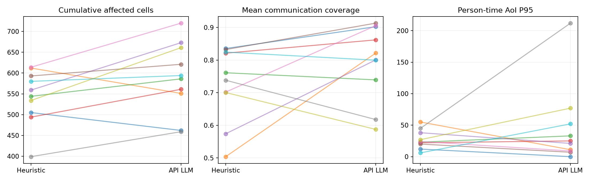
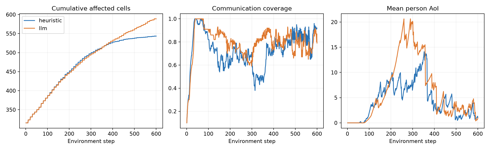

> **已由正式完整实验替代。** 请阅读 `../brain_comparison_20261022_recovered/report.md`。本文件保留初次 API 故障与混合轨迹的分析，不作为最终纯大模型对比结论。

# 大模型与启发式对比实验报告

**实验状态：部分完成。** 20 局仿真都已跑完，但 10 局 API 组后段均遇到服务商权限拒绝（`HTTP 403 / AccessDenied.Unpurchased`），共 78 次决策回退。**不能把它们当成 10 局全程纯大模型实验。** 一次独立的小请求健康检查也返回同样的 403；本地无法修复服务商模型访问权限。

可以判断的是：**当前配置尚未体现出替代启发式的收益。** 在全部 10 对均未发生回退的前 380 步，LLM 组平均累计过火 522.4 格，启发式 521.1 格，变化 +0.2%。 全程 API+回退系统的过火也更高。不能据此断言大模型方法本身无价值，也不能把后段差异全部归因于大模型。

## 不含回退的共同前缀：10 对 × 380 步

前 380 步为所有场景中首次 API 失败前的最长共同区间：每局前 19 次规划全部来自真实 qwen-plus API，双方使用同一新 Actor 和协议。380 是由接口故障事后确定的辅助窗口，**不是预先设计的 600 步主实验**。它有助于排除回退污染，但不能代替完整任务验收。

| 指标 | 启发式 | 纯 API LLM | LLM − 启发式 | 配对 95% bootstrap 区间 | LLM 胜/平/负 |
|---|---:|---:|---:|---|---|
| 第 380 步累计过火格数 | 521.1000 | 522.4000 | +1.3000 | [-23.1025, +24.7000] | 4/0/6 |
| 第 380 步已扑灭格数 | 177.7000 | 142.4000 | -35.3000 | [-57.7000, -16.0000] | 1/0/9 |
| 第 380 步人员火情认知率 | 0.7149 | 0.5185 | -0.1964 | [-0.3651, -0.0555] | 2/0/8 |
| 第 380 步探索率 | 0.7439 | 0.5368 | -0.2071 | [-0.2643, -0.1596] | 0/0/10 |
| 全程平均通信覆盖率 | 0.6840 | 0.7942 | +0.1102 | [+0.0230, +0.2009] | 8/0/2 |
| 人员×时间 AoI 的 P95 | 32.9100 | 48.1150 | +15.2050 | [-18.4050, +58.0122] | 5/0/5 |
| 前 380 步平均人员火情认知率 | 0.4466 | 0.3417 | -0.1049 | [-0.1638, -0.0406] | 2/0/8 |

累计过火不是短窗 shaped reward，而是到第 380 步实际累计受灾格数。但短于完整任务，后续排名仍可能改变。所有区间按 10 个场景重采样，未按时间步伪造大样本。

## API 故障与结果边界

- 300 次逻辑决策中，222 次成功生成计划；78 次回退。305 次 HTTP 尝试中，5 次限流（429，均恢复），78 次权限拒绝（403，未恢复）。
- 成功 HTTP 调用中位耗时 17.71 秒，P95 27.11 秒；总输入 31,682,470 token，输出 20,541 token。独立健康检查未成功，无额外 token usage。
- 服务商错误说明模型访问资格/购买状态有问题；它没有提供足以确认“余额不足”的证据，不能把错误原因直接说成欠费。
- `api_health_check.json`、逐调用日志及原始决策都已保存。恢复脚本会重放已付费的有效前缀，检查输入一致，再从首次失败处调用 API，失败即停，不再混入启发式。
- 不使用 API 故障之后偶尔成功的调用来拼接“纯 LLM”轨迹，因为它们的环境状态已受先前启发式回退影响。

## 600 步全程结果：API+启发式回退系统

下文所有 API 组全程统计均含回退。用途是描述实际系统效果，不是全程纯 LLM 能力结论。

主指标累计过火格数：启发式均值 543.4，API混合组均值 588.8；API混合组相对变化 +8.4%。在这组种子上，启发式的过火面积较低。结论仅限本协议和当前场景族。其中 78 次决策回退为启发式，因此 API混合组实际是带回退的 API 系统。

## 实验是否完整

完成 10/10 对，共 20/20 局。每局 600 步，每 20 步规划一次。初始状态指纹、Actor SHA-256 和步数已逐对核验。
使用权重：`dfa5cdd0f4b673567c04220af9d82ee55f16920d55398a02471a0d535d59982e`。没有重新训练或更换低层模型。

## 协议与可解释范围

- 100×100 地图，4 架无人机，10 名人员，3 个初始火源；随机风；种子 730000–730009。
- 双方共用目标管理、最近真实补给点保护、纯 Actor argmax；无航点动作接管，不因合围、活火归零或全机耗尽提前停局。
- 目标协议统一为：显式改变计划立即接受；重复未完成目标保留，已完成/失效探索目标按同一采样器更新。网页原先按来源区别处理，本实验只在独立 runner 中消除了该差异。
- LLM 调用项目既有 API、模型名 qwen-plus、temperature=0.2，使用现有提示词与完整真值快照（含全格火情、地形、人员、无人机、能量和规则）。启发式收到同一个状态结构，但现有规则只消费简报。
- 因此这是当前系统的效果对比，不是有效信息量完全相等的纯推理能力实验；LLM 若有收益，不能排除真值信息的贡献。
- 仿真在调用 API 时暂停。延迟独立记录，没有模拟推理期间火势继续演化，因此没有检验决策过期问题。
- 每个场景每组只跑一次。环境/Actor 固定，API temperature=0.2 仍可能有随机性，未估计同种子多次 API 波动。

## 指标结果

差值统一为“大模型 − 启发式”。区间按场景为单位重采样 20,000 次；n=10，区间只是小样本不确定性描述。AoI 与覆盖使用整局，不把 6,000 个时间步当独立试验。

| 指标 | 启发式均值 | API混合组均值 | 配对均差 | 95% bootstrap 区间 | API混合组胜/平/负 |
|---|---:|---:|---:|---|---|
| 最终累计过火格数 | 543.4000 | 588.8000 | +45.4000 | [+7.6975, +80.9000] | 2/0/8 |
| 最终已扑灭格数 | 242.6000 | 189.7000 | -52.9000 | [-80.8000, -26.0000] | 1/0/9 |
| 最终人员火情认知率 | 0.8935 | 0.7060 | -0.1875 | [-0.3926, -0.0202] | 2/3/5 |
| 最终探索率 | 0.8469 | 0.6948 | -0.1521 | [-0.1999, -0.1056] | 0/0/10 |
| 全程平均通信覆盖率 | 0.7293 | 0.7950 | +0.0656 | [-0.0175, +0.1535] | 6/0/4 |
| 人员×时间 AoI 的 P95 | 27.2000 | 44.7050 | +17.5050 | [-12.4950, +56.8050] | 5/0/5 |
| 最长连续未覆盖步数 | 63.3000 | 93.6000 | +30.3000 | [-11.2000, +79.3025] | 5/0/5 |
| 曾耗尽的无人机数 | 0.0000 | 0.3000 | +0.3000 | [+0.0000, +0.6000] | 0/7/3 |
| 指令改变次数（逐机） | 71.0000 | 57.4000 | -13.6000 | [-19.3000, -7.3000] | — |

累计过火为最终 `burning_state > 0` 的格数，包含燃烧、烧尽和已扑灭区域；它衡量累计受灾足迹。已扑灭数单独列出，更多已扑灭不自动代表损失更小。最终人员认知率可能饱和，需结合全程通信/AoI 看。





## 逐种子主指标

| 种子 | 启发式过火 | LLM 过火 | 差值 | LLM 回退 |
|---|---:|---:|---:|---:|
| 730000 | 505 | 462 | -43 | 3 |
| 730001 | 612 | 551 | -61 | 5 |
| 730002 | 544 | 586 | +42 | 6 |
| 730003 | 494 | 561 | +67 | 8 |
| 730004 | 559 | 673 | +114 | 9 |
| 730005 | 593 | 621 | +28 | 10 |
| 730006 | 614 | 720 | +106 | 10 |
| 730007 | 399 | 459 | +60 | 10 |
| 730008 | 534 | 661 | +127 | 8 |
| 730009 | 580 | 594 | +14 | 9 |

## API 成本与失败

```json
{
  "logical_calls": 300,
  "successful_llm_decisions": 222,
  "fallback_decisions": 78,
  "http_attempts": 305,
  "failed_attempts": 83,
  "latency_median_s": 17.522426854498917,
  "latency_p95_s": 26.437032877111054,
  "prompt_tokens": 31682470,
  "completion_tokens": 20541,
  "returned_models": [
    "qwen-plus"
  ]
}
```

token 数按 API usage 原样累计；没有价格配置，未虚构货币费用。所有传输尝试及失败有日志；失败后启发式回退没有被当作 LLM 成功。

## 数据与复现

- `manifest.json`：冻结配置、代码哈希、种子和协议。
- `episodes.csv`、`analysis.json`：逐局指标、配对统计与 API 汇总；精确符号翻转检验仅作探索，未多重比较校正。
- `{arm}_{seed}/initial_state.json.gz`：初态完整信息；`steps.jsonl`：每步指标、位置、电量、指令、动作和人员 AoI。
- `llm_*/call_*_request.json.gz` / `response.json.gz`：实际消息和供应商原始响应，不含 Authorization 或 API key；`api_attempts.jsonl`：时延、usage 与重试。
- `decisions.jsonl`、`charge_overrides.jsonl`：请求计划、实际应用计划、目标管理/安全修正、解析回退。
- 实验源码：`experiments/brain_comparison/run.py`、`launch.py`、`report.py`。环境使用项目已有 Python 3.13 依赖；见 `REPRODUCE.md`。

## 对“大模型价值”的判断

现阶段应按任务结果与调用开销一起判断。结果只能回答当前提示词、完整信息模式、现有执行器及标准场景是否获益；不能证明所有大模型或未来 Critic 方法无价值。若 LLM 仍输，优先检查逐步指令频繁切换、人员链路选择与执行器巡逻局限的实际轨迹证据，不能仅凭成绩把原因归为模型能力或提示词。若 LLM 赢，也应补充同信息量和真实延迟对照，才能支持论文中的机制主张。

## 轨迹行为核查（关联证据，不等于因果消融）

以下按真实应用指令统计，包含公共目标更新和充电保护；每组共 24,000 个无人机×时间步。

| 全程行为 | 启发式 | API 大模型 |
|---|---:|---:|
| 探索指令占比 | 51.7% | 36.6% |
| 巡逻指令占比 | 8.7% | 15.1% |
| 中继指令占比 | 28.9% | 33.1% |
| 充电指令占比 | 10.8% | 15.2% |
| 全程平均人员火情认知率（全部真实燃烧格口径） | 0.587 | 0.435 |
| 到达 70% 探索的局数 | 10/10 | 4/10 |
| 每局逐机指令变化均数 | 71.0 | 57.4 |

人员认知率分母会随火势和扑灭变化，不能单独用来给“中继质量”作因果结论；这里与过火、覆盖和 AoI 联合阅读。

### 两个代表性场景

种子 **730001**：LLM − 启发式累计过火差 -61 格。
- heuristic：过火 612，扑灭 170，探索 76.2%，平均覆盖 50.4%，AoI P95 55.0，指令变化 68；角色步数 `{"explore": 1260, "relay": 680, "charge": 300, "patrol": 160}`。
- llm：过火 551，扑灭 143，探索 62.7%，平均覆盖 82.2%，AoI P95 11.0，指令变化 61；角色步数 `{"relay": 685, "explore": 796, "patrol": 300, "charge": 619}`。

种子 **730008**：LLM − 启发式累计过火差 +127 格。
- heuristic：过火 534，扑灭 264，探索 90.6%，平均覆盖 70.1%，AoI P95 27.0，指令变化 77；角色步数 `{"explore": 1300, "relay": 680, "charge": 260, "patrol": 160}`。
- llm：过火 661，扑灭 206，探索 59.8%，平均覆盖 58.8%，AoI P95 77.0，指令变化 61；角色步数 `{"relay": 822, "explore": 695, "patrol": 380, "charge": 503}`。

这是按主指标选出的最好/最差差值案例，不能当作独立复现。完整逐局轨迹均已保留，未只保留有利场景。


## 当前处置建议

当前演示与性能基线继续保留启发式。先恢复 qwen-plus 的模型访问资格，再完成原定 600 步纯 API 任务；不要根据这次受故障影响的结果去重训底层。现有纯前缀已显示“给全部数据”并没有自动带来收益，下一轮应比较信息组织与任务选择，特别是高层决策对应的实际观测/回传效果。这里只是待检验方向，未用本轮数据调参后重复报分。

## 继续运行与交付核验

恢复接口后可执行 `experiments/brain_comparison/recover.py <seed>`（730000–730009），输出到单独的 `research_outputs/brain_comparison_20261022_recovered/`。已付费决策从磁盘重放，不重复调用；在首次失败处开始新的 API 调用，并在任何回退发生前立即停止。恢复结果不得和原混合数据混写。

`audit.json` 记录 20 局步数、600 次规划、初态一致性与凭据排除检查；`pure_prefix_analysis.json` 为辅助纯前缀统计；`recovery_points.json` 为各局恢复边界。
