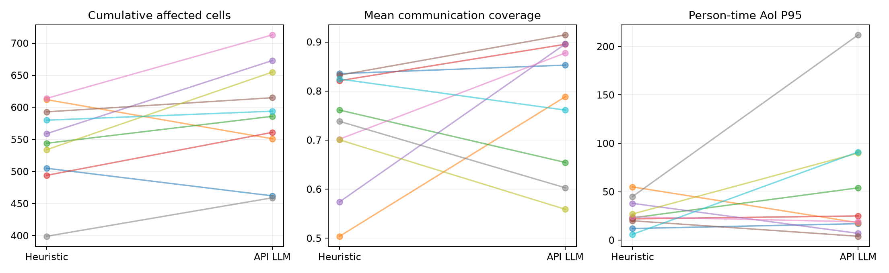
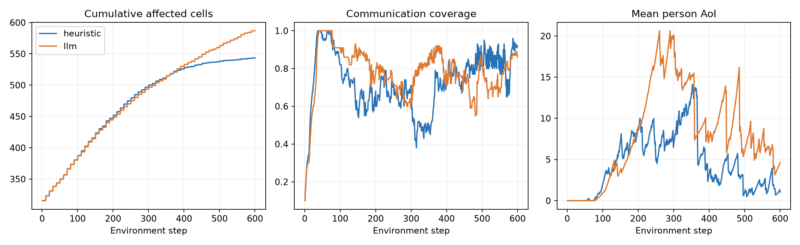

# 大模型与启发式：正式 10×2 局对比报告

完整正式实验已完成：**10 局纯 API 大模型 + 10 局启发式**，每局 600 步、同种子配对、同新 Actor、无 API 回退。累计过火：启发式均值 543.4，大模型 586.9，变化 +8.0%；配对差 95% bootstrap 区间 [+6.5, +78.2] 格。在当前配置和这组场景中，启发式的累计过火更少。

初次实验曾受 API 故障影响；已通过严格重放与续跑补齐纯 API 组。本报告的任务指标只使用最终纯组；初次混合数据保留作故障证据，未混入成绩。

## 实验是否完整

完成 10/10 对，共 20/20 局。每局 600 步，每 20 步规划一次。初始状态指纹、Actor SHA-256 和步数已逐对核验。
使用权重：`dfa5cdd0f4b673567c04220af9d82ee55f16920d55398a02471a0d535d59982e`。没有重新训练或更换低层模型。

## 协议与可解释范围

- 100×100 地图，4 架无人机，10 名人员，3 个初始火源；随机风；种子 730000–730009。
- 双方共用目标管理、最近真实补给点保护、纯 Actor argmax；无航点动作接管，不因合围、活火归零或全机耗尽提前停局。
- 目标协议统一为：显式改变计划立即接受；重复未完成目标保留，已完成/失效探索目标按同一采样器更新。网页原先按来源区别处理，本实验只在独立 runner 中消除了该差异。
- LLM 调用项目既有 API、模型名 qwen-plus、temperature=0.2，使用现有提示词与完整真值快照（含全格火情、地形、人员、无人机、能量和规则）。启发式收到同一个状态结构，但现有规则只消费简报。
- 因此这是当前系统的效果对比，不是有效信息量完全相等的纯推理能力实验；LLM 若有收益，不能排除真值信息的贡献。
- 仿真在调用 API 时暂停。延迟独立记录，没有模拟推理期间火势继续演化，因此没有检验决策过期问题。
- 每个场景每组只跑一次。环境/Actor 固定，API temperature=0.2 仍可能有随机性，未估计同种子多次 API 波动。

## 指标结果

差值统一为“大模型 − 启发式”。区间按场景为单位重采样 20,000 次；n=10，区间只是小样本不确定性描述。AoI 与覆盖使用整局，不把 6,000 个时间步当独立试验。

| 指标 | 启发式均值 | 大模型均值 | 配对均差 | 95% bootstrap 区间 | 大模型胜/平/负 |
|---|---:|---:|---:|---|---|
| 最终累计过火格数 | 543.4000 | 586.9000 | +43.5000 | [+6.5000, +78.2000] | 2/0/8 |
| 最终已扑灭格数 | 242.6000 | 186.7000 | -55.9000 | [-85.2000, -27.3000] | 1/0/9 |
| 最终人员火情认知率 | 0.8935 | 0.5023 | -0.3912 | [-0.6404, -0.1447] | 1/3/6 |
| 最终探索率 | 0.8469 | 0.6301 | -0.2168 | [-0.2768, -0.1616] | 0/0/10 |
| 全程平均通信覆盖率 | 0.7293 | 0.7802 | +0.0509 | [-0.0456, +0.1524] | 6/0/4 |
| 人员×时间 AoI 的 P95 | 27.2000 | 53.7100 | +26.5100 | [-6.8951, +67.4151] | 4/0/6 |
| 最长连续未覆盖步数 | 63.3000 | 103.2000 | +39.9000 | [-3.9000, +89.8000] | 3/0/7 |
| 曾耗尽的无人机数 | 0.0000 | 0.2000 | +0.2000 | [+0.0000, +0.5000] | 0/8/2 |
| 指令改变次数（逐机） | 71.0000 | 51.9000 | -19.1000 | [-25.3000, -11.9000] | — |

累计过火为最终 `burning_state > 0` 的格数，包含燃烧、烧尽和已扑灭区域；它衡量累计受灾足迹。已扑灭数单独列出，更多已扑灭不自动代表损失更小。最终人员认知率可能饱和，需结合全程通信/AoI 看。





## 逐种子主指标

| 种子 | 启发式过火 | LLM 过火 | 差值 | LLM 回退 |
|---|---:|---:|---:|---:|
| 730000 | 505 | 462 | -43 | 0 |
| 730001 | 612 | 551 | -61 | 0 |
| 730002 | 544 | 586 | +42 | 0 |
| 730003 | 494 | 561 | +67 | 0 |
| 730004 | 559 | 673 | +114 | 0 |
| 730005 | 593 | 615 | +22 | 0 |
| 730006 | 614 | 713 | +99 | 0 |
| 730007 | 399 | 459 | +60 | 0 |
| 730008 | 534 | 655 | +121 | 0 |
| 730009 | 580 | 594 | +14 | 0 |

## API 成本、故障恢复与统计口径

```json
{
  "formal_decisions": 300,
  "formal_fallbacks": 0,
  "paid_prefix_replayed_decisions": 209,
  "formal_prompt_tokens_including_paid_prefix": 42623793,
  "formal_completion_tokens_including_paid_prefix": 27382,
  "formal_decision_historical_latency_median_s": 17.620963166504225,
  "formal_decision_historical_latency_p95_s": 26.437032877111054,
  "all_experiment_http_attempts_including_discarded_mixed_runs": 396,
  "all_experiment_successful_requests": 313,
  "all_experiment_prompt_tokens": 44442122,
  "all_experiment_completion_tokens": 28478,
  "all_experiment_http_errors": 83,
  "health_probe_note": "One extra small health request failed HTTP 403; no usage returned; excluded from rollout counts."
}
```

正式组全部 300 次决策均由真实 API 生成；恢复时前缀读取原始响应，输入逐字核对一致，整段动作/轨迹逐条核验一致。前缀只付费一次，没有重新采样或挑选更优方案。恢复后的新决策发生于原首次失败处，任何 API 回退均立即停局，未进入正式成绩。

初次 10 路并发时出现 5 次 429 及后续间歇性 403，导致 78 次启发式回退；这些原始混合局已排除。将恢复批次降低至 4 路（开始时另有 1 路验证）并有限重试后补齐所有纯 API 局。接口恢复与并发变化同时发生，无法仅凭本轮证据确定 403 的服务商根因。所有故障日志仍在原目录。

时延按原调用历史计算，不把免费本地重放的约零秒当作模型推理时间；正式决策 token 与所有实际支出 token 分别统计，后者还包含后来被排除的混合轨迹调用。未配置供应商价格，未虚构金额。

## 数据与复现

- `manifest.json`：冻结配置、代码哈希、种子和协议。
- `episodes.csv`、`analysis.json`：逐局指标、配对统计与 API 汇总；精确符号翻转检验仅作探索，未多重比较校正。
- `{arm}_{seed}/initial_state.json.gz`：初态完整信息；`steps.jsonl`：每步指标、位置、电量、指令、动作和人员 AoI。
- `llm_*/call_*_request.json.gz` / `response.json.gz`：实际消息和供应商原始响应，不含 Authorization 或 API key；`api_attempts.jsonl`：时延、usage 与重试。
- `decisions.jsonl`、`charge_overrides.jsonl`：请求计划、实际应用计划、目标管理/安全修正、解析回退。
- 实验源码：`experiments/brain_comparison/run.py`、`launch.py`、`report.py`。环境使用项目已有 Python 3.13 依赖；见 `REPRODUCE.md`。

## 对“大模型价值”的判断

现阶段应按任务结果与调用开销一起判断。结果只能回答当前提示词、完整信息模式、现有执行器及标准场景是否获益；不能证明所有大模型或未来 Critic 方法无价值。若 LLM 仍输，优先检查逐步指令频繁切换、人员链路选择与执行器巡逻局限的实际轨迹证据，不能仅凭成绩把原因归为模型能力或提示词。若 LLM 赢，也应补充同信息量和真实延迟对照，才能支持论文中的机制主张。

## 轨迹行为核查（关联证据，不等于因果消融）

以下按真实应用指令统计，包含公共目标更新和充电保护；每组共 24,000 个无人机×时间步。

| 全程行为 | 启发式 | API 大模型 |
|---|---:|---:|
| 探索指令占比 | 51.7% | 32.0% |
| 巡逻指令占比 | 8.7% | 19.0% |
| 中继指令占比 | 28.9% | 33.5% |
| 充电指令占比 | 10.8% | 15.5% |
| 全程平均人员火情认知率（全部真实燃烧格口径） | 0.587 | 0.405 |
| 到达 70% 探索的局数 | 10/10 | 3/10 |
| 每局逐机指令变化均数 | 71.0 | 51.9 |

人员认知率分母会随火势和扑灭变化，不能单独用来给“中继质量”作因果结论；这里与过火、覆盖和 AoI 联合阅读。

### 两个代表性场景

种子 **730001**：LLM − 启发式累计过火差 -61 格。
- heuristic：过火 612，扑灭 170，探索 76.2%，平均覆盖 50.4%，AoI P95 55.0，指令变化 68；角色步数 `{"explore": 1260, "relay": 680, "charge": 300, "patrol": 160}`。
- llm：过火 551，扑灭 139，探索 62.1%，平均覆盖 78.9%，AoI P95 18.0，指令变化 54；角色步数 `{"relay": 638, "explore": 756, "patrol": 380, "charge": 626}`。

种子 **730008**：LLM − 启发式累计过火差 +121 格。
- heuristic：过火 534，扑灭 264，探索 90.6%，平均覆盖 70.1%，AoI P95 27.0，指令变化 77；角色步数 `{"explore": 1300, "relay": 680, "charge": 260, "patrol": 160}`。
- llm：过火 655，扑灭 229，探索 63.1%，平均覆盖 55.9%，AoI P95 90.0，指令变化 52；角色步数 `{"relay": 807, "explore": 602, "patrol": 527, "charge": 464}`。

这是按主指标选出的最好/最差差值案例，不能当作独立复现。完整逐局轨迹均已保留，未只保留有利场景。

## 如何解释大模型价值

本轮评估的是“现有 qwen-plus 提示词 + 全量真值输入 + 当前低层执行器 + 同步规划”的整体方案。不要把任务分配表现直接等同于底层指令执行能力。平均覆盖上升未必意味着新火情发现与回传改善：中继收到的可能是过时地图，探索与巡逻的时间分配也会影响任务。行为表与逐步轨迹提供关联证据；没有做对应因果消融，不能宣称已证实某个失败机制。

如果累计过火或灭火结果没有优势，当前保留启发式作为部署基线更合适；大模型是否适合作 Critic、事件处理或选择性介入需要另外设计实验。本轮没有测试自然语言事件、真实时间推理延迟或场景外泛化，也没有在同种子上重复多次 API 采样。

## 本轮最直接的行为线索

大模型的探索指令占比为 32.0%，启发式为 51.7%；巡逻占比为 19.0% 对 8.7%，中继为 33.5% 对 28.9%。这与“大模型覆盖较高，但新区域探索和人员火情认知较低”的结果相吻合，提示资源分配偏好值得优先检查。它是关联线索，尚不是奖励或规划机制的因果证明。

大模型每局逐机指令变化平均 51.9 次，启发式 71.0 次。因此本轮数据不支持“大模型因为更频繁改目标而退化”的解释。低层是否在 patrol 时抖动，则要另看动作轨迹，不能把高层切换数当作底层抖动指标。

现阶段建议保留启发式为主规划基线。若继续开发大模型，优先研究它能否识别“增加中继没有增加有效新火情”的状态，并给出可执行的任务调整；这与后续精确 Critic 的方向一致，但需要新的消融实验证明。
