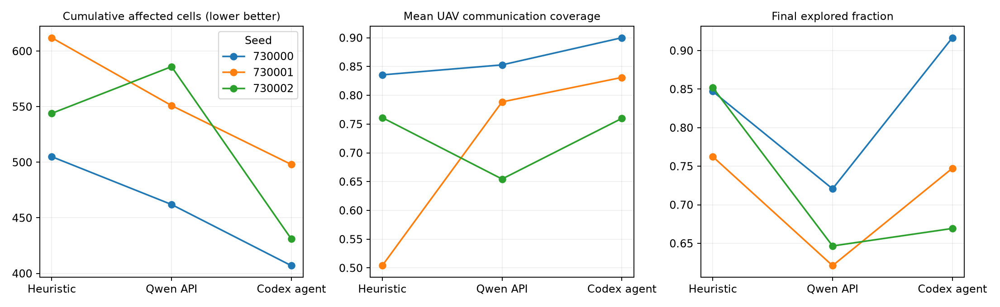

# Codex 亲自担任高层大脑：三局实测

完成 **3 局 × 600 步，90 次显式 agent 决策**。不调用千问或其他外部 LLM API；使用当前 Codex 会话额度、工具调用和持续上下文。没有训练 Actor、改奖励、改火势规则或接管底层动作。

同种子对比，Codex 平均累计过火 **445.3 格**，启发式 **553.7 格**，变化 **-19.6%**。三局均较启发式过火少、无无人机耗尽。探索率未全面超过启发式，通信/AoI 也有场景差异，不能称为全面胜出。

## 对比协议与边界

- 种子固定为原实验的前三个：730000、730001、730002；在运行前选定，没有按成绩换种子或重跑选优。
- 沿用 100×100、4 UAV、10 人员、3 初始火源、随机风、600 步，每 20 步集中规划一次。新 Actor SHA-256：`dfa5cdd0f4b673567c04220af9d82ee55f16920d55398a02471a0d535d59982e`。
- 初始状态哈希、Actor、充电保护、目标管理和 argmax 动作与原实验逐局一致。既有启发式和千问数据直接复用，没有新调用费用。
- 每个决策边界暂停。我读取当前火场、人员、能量、目标进度及未知网格分块，逐次写入四机 JSON 指令；桥接程序只等待/执行明确指令，不生成启发式方案，不替我选择任务。
- 保存完整逐格快照供检查。实际使用工具将当前状态压缩成火场质心/规模、分块未知格数、位置、电量、AoI、真实覆盖、目标进度；没有把所有原始地形数字逐字读入当前会话。
- 我在实验前已知道旧报告和 Actor 的能力缺陷，并能读取代码及定位反馈问题。因此是 **Codex agent + 状态分析工具 + 持续上下文** 的系统测试，不是与 qwen-plus 同提示词、同工具预算的裸模型能力排名，也不是未见场景的泛化测试。
- 不查询未来轨迹、不做环境分叉/候选方案 rollout、不读取本局基线未来动作。三局仅各运行一次；规划过程根据实际反馈调整。
- 仿真在决策期间暂停，仍未检验真实时间推理延迟与决策过期。

## 三局累计过火对照

| 种子 | 启发式 | 千问 API | Codex agent | Codex 相对启发式 |
|---|---:|---:|---:|---:|
| 730000 | 505 | 462 | 407 | -19.4% |
| 730001 | 612 | 551 | 498 | -18.6% |
| 730002 | 544 | 586 | 431 | -20.8% |

## 指标均值（仅这三个配对种子）

| 指标 | 启发式 | 千问 API | Codex agent |
|---|---:|---:|---:|
| 累计过火格数 ↓ | 553.67 | 533.00 | 445.33 |
| 已扑灭格数 ↑ | 232.67 | 185.00 | 234.67 |
| 最终探索率 ↑ | 82.0% | 66.3% | 77.8% |
| 最终人员火情认知率 ↑ | 69.1% | 69.7% | 100.0% |
| 全程平均无人机通信覆盖率 ↑ | 70.0% | 76.5% | 83.0% |
| 全程平均人员 AoI ↓ | 5.64 | 4.33 | 1.88 |
| 每局人员×时间 AoI P95 的均值 ↓ | 30.00 | 29.67 | 13.00 |
| 每局最长连续未覆盖步数的均值 ↓ | 69.00 | 65.00 | 49.00 |
| 曾耗尽无人机数 ↓ | 0.00 | 0.33 | 0.00 |

累计过火为 `burning_state > 0` 的最终格数，包含燃烧、烧尽及扑灭。合围意味着火不再向外扩散，不意味着活火格数为零；三局最终仍有 7、46、7 格真实燃烧，因此不能把合围写成“全部扑灭”。

## 真实火场合围确认

下表为每 20 步决策快照中首次确认“全部真实火场都已合围”的时刻，属于采样确认时刻，不是逐步精确首次完成时刻。

| 种子 | 启发式 | 千问 API | Codex agent |
|---|---:|---:|---:|
| 730000 | 420 | 460 | 280 |
| 730001 | 580步前未确认 | 580步前未确认 | 380 |
| 730002 | 560 | 580步前未确认 | 260 |

## 实际采取的策略与观察到的问题

1. **先看火场，再铺全图。** 用完整当前真值把三架感知机分到不同真实火场边缘，留一架中继。随后随人员分成两组、三组调整覆盖，没有固定要求永远一架或两架中继。这个策略利用真值；相对启发式的收益不能全部归因于模型推理。
2. **根据当前 Actor 调整指令。** 多用显式 explore 观测航点刷新火线，没有依赖已知较弱的持续环绕能力。观察到某些点的局部观测进度停滞后再换位置。
3. **提前接班、再补给。** 用实际能量和可达补给点安排交接；底层动作和所有安全修正仍由原公共协议执行。三局均没有电量耗尽，但不能据此声称已经证明所有场景的补给可靠性。
4. **处理执行反馈。** 种子730000的t400–420，UAV1和UAV2分别停在(30,30)/(29,29)，快照两机blocked均为true；检查原代码确认占位冲突后，t420给UAV1北移航点，t440两机位置分别到(30,42)/(48,34)，恢复推进。没有改变碰撞规则或直接指定动作。
5. **目标协议也会改变结果。** 种子730001的t400请求维持探索点(66,58)，t420实际目标被公共目标管理器改成(61,79)。随后改成固定点中继、验证实际坐标，再用当前可同时覆盖两人的位置保持。相关requested/applied/goal_notes均保存，不把自动修正后的计划冒充原始意图。
6. **存在代价。** 第二、三局探索率只有74.73%、66.93%，第三局早先有人员失联68步；在火场合围后更偏向保障静止、分散人员覆盖，减少了广域探索投入。最终好看不等于过程没有缺口。

这些是单次运行中的行为与事件证据，不是因果消融，不能证明每项措施分别贡献了多少收益。

## 对项目方向的含义

本轮支持继续研究“面向执行反馈的高层建议”：需要看实际执行位置、覆盖对象、观测收益和能量余量，再提出具体变更，而非只给宏观任务标签。但它没有证明必须换更大的模型，也没有证明 Actor 已完全可靠；占位冲突和自动改目标说明系统接口仍会影响结果。下一步若要论文证据，应把航点刷新、反馈纠偏、交接补给拆成消融，并在新留出场景和相同信息/工具预算下比较。

## 数据、复现与用量

- `codex_<seed>/command_*.json`：90份亲自下发的计划与简短决策依据；`decisions.jsonl`：requested/applied、公共协议修正和来源。
- `state_*.json.gz`：每次决策完整环境快照；`steps.jsonl`：1,800步动作、位置、电量、AoI和任务指标；`summary.json`：逐局汇总。
- `comparison.csv`、`analysis.json`、`audit.json`：三组同种子比较与完整性校验。
- `protocol.json`、`evaluation_sources/`：运行协议与桥接/控制/报告源码；公共执行代码复用 `experiments/brain_comparison/run.py`。
- 所有外部千问API调用数为0。当前Codex额度不等于免费，未读取或估算账户消耗金额。三局并行墙钟约13.7分钟，`planning_seconds`主要是等待当前会话决策和工具交互时间，不能拿它与17.6秒API推理中位数直接做速度排名。
- 重放已保存决策可复现这三条轨迹；重新让我自由规划可能产生不同结果。没有把未运行的策略包装成可确定复现的自动规划器。

本轮仅3个旧基准种子，不做小样本显著性或论文级泛化主张。

## 确定性重放验收

已用保存的90份指令重放全部三局，逐步比较1,800个完整转移记录：动作、实际指令、位置、电量、AoI及任务指标全部与原轨迹一致。重放不调用模型或API、不作为额外独立试验，证据位于replay_verification/。
