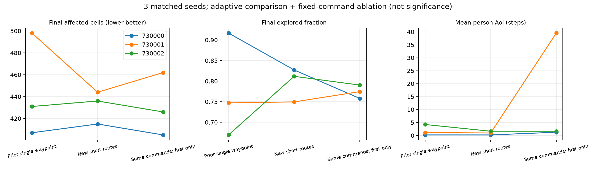
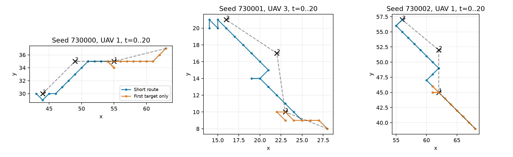

# 冻结Actor短航迹转化器：三局对比实验

**结论：接口可用，但尚未证明明显、稳定的任务提升。** 与上一轮由我规划的单航点三局相比，平均过火从431.7降至445.3格（+3.2%）；逐局是两局略差、一局改善。不能把这一均值变化全部归因于转化器。

在保存同一批指令、关闭自动切点且只执行首点的重放中，开启航迹后的平均过火变化为+3.3%。这一对照用于检查当前这批航迹的贡献，不是另一个会适应新状态的大脑。

## 实验设置

- 我在每次收到当前状态后亲自给出指令：3个种子730000–730002，每局600步，每20步决策，共90条显式计划；没有用启发式替代我规划。
- 使用现有actor_selected.pt，冻结权重、argmax执行，不重新训练，不调用千问API。初态哈希与此前三局一致，公共目标管理及充电保护保持一致。
- 每次保存全量100×100环境快照；我读取当前火区、人员、无人机、电量、5×5未知区计数与上一段执行反馈。没有查询未来轨迹或搜索候选计划收益。
- 直线任务继续输出一个航点，可持续多个窗口；仅局部转弯输出2–4点折线。折线含当前位置的各段切比雪夫距离之和不得超过20，连续点间距至少4格，纯共线序列拒绝。该预算是理想航程下界，不保证Actor或避碰必定20步走完。
- 转化器每个底层步检查目标：距离≤2.5切点，也允许通过目标垂线且横向偏差≤2.5；距离≤4且连续4次无进展可切点，单独记录。末点完成后本窗口保持，充电可抢占，窗口结束不自动跨窗继续。
- 航迹是稀疏折线提示，没有训练曲率/速度跟踪；2.5格容差会切弯，不能称为精确平滑曲线跟踪。
- 本次仅把新接口接入实验运行器，未修改现有前端和千问提示词。

## 逐局结果

| 种子 | 旧单航点过火 | 新航迹过火 | 新−旧 | 仅首点重放过火 | 旧探索率 | 新探索率 |
|---|---:|---:|---:|---:|---:|---:|
| 730000 | 407 | 415 | +8 | 405 | 91.66% | 82.71% |
| 730001 | 498 | 444 | -54 | 462 | 74.73% | 74.95% |
| 730002 | 431 | 436 | +5 | 426 | 66.93% | 81.17% |

## 多指标均值

每局先计算指标，再对三局等权平均。↓越低越好；未标方向的量只描述行为，不做越大越好的假设。

| 指标 | 旧单航点（自适应） | 新航迹（自适应） | 同新指令仅首点（固定重放） |
|---|---:|---:|---:|
| 累计过火格数 ↓ | 445.33 | 431.67 | 431.00 |
| 新增过火格数 ↓ | 144.33 | 130.67 | 130.00 |
| 未合围燃烧暴露积分 ↓ | 69,406.00 | 64,255.67 | 63,719.67 |
| 稳定合围耗时 ↓ | 300.33 | 289.33 | 281.67 |
| 最终烧尽格数 ↓ | 190.67 | 188.33 | 187.67 |
| 最终扑灭格数 | 234.67 | 233.00 | 230.67 |
| 最终余火格数 ↓ | 20.00 | 10.33 | 12.67 |
| 最终探索率 ↑ | 77.77% | 79.61% | 77.43% |
| 全程平均探索率 ↑ | 54.78% | 50.52% | 49.73% |
| 未合围火人员认知率 ↑ | 74.16% | 75.65% | 73.55% |
| 全部燃烧人员认知率 ↑ | 81.37% | 82.55% | 81.27% |
| 平均UAV通信覆盖 ↑ | 83.03% | 87.05% | 74.33% |
| 含基站平均通信可用率 ↑ | 87.67% | 91.83% | 78.95% |
| 平均人员AoI ↓ | 1.88 | 0.95 | 14.14 |
| 人员AoI P95 ↓ | 13.00 | 5.33 | 84.33 |
| 人员AoI P99 ↓ | 29.67 | 25.67 | 116.34 |
| AoI>20人员时间占比 ↓ | 3.25% | 1.46% | 11.42% |
| 最长连续中断 ↓ | 49.00 | 42.33 | 135.67 |
| 被其他无人机阻挡占比 ↓ | 0.58% | 0.00% | 0.04% |
| 越界尝试占比 ↓ | 0.00% | 0.00% | 0.00% |
| 相邻移动立即折返率 | 31.45% | 27.06% | 25.36% |
| 四机总实际航程 | 2,999.28 | 2,986.04 | 2,985.46 |
| 实际逐机指令变化数 | 63.33 | 108.00 | 71.33 |
| 全程最低电量 | 60.00 | 78.33 | 30.83 |
| 最低理想返航余量 | 53.33 | 75.83 | 18.33 |
| 曾耗尽架数 ↓ | 0.00 | 0.00 | 0.00 |
| 探索任务时间占比 | 46.67% | 40.83% | 39.40% |
| 中继任务时间占比 | 45.28% | 47.78% | 45.61% |
| 充电任务时间占比 | 8.06% | 11.39% | 14.99% |
| 终局未合围燃烧格数 ↓ | 0.00 | 0.00 | 0.00 |
| 终局无未合围火比例 ↑ | 100.00% | 100.00% | 100.00% |

过火包含燃烧、烧尽和扑灭；合围不等于余火归零。稳定合围时刻来自每步真值，取最后一次未合围燃烧之后的首步，旧报告20步快照时刻与此可相差1–19步。未合围火人员认知率使用燃烧格·步加权，避免后半局默认1掩盖早期问题。AoI的单位是环境步，不是真实秒。返航余量是到最近真实充电站的无阻挡最短步下界，不是安全保证。

## 航迹执行

| 种子 | 航迹数 | 按切换规则完成 | 全部点均≤2.5格 | 窗口内自动切点 | 近点停滞放行 | 末点完成后保持机步 |
|---|---:|---:|---:|---:|---:|---:|
| 730000 | 23 | 23 | 23 | 46 | 0 | 94 |
| 730001 | 16 | 15 | 15 | 32 | 0 | 75 |
| 730002 | 19 | 18 | 18 | 37 | 0 | 81 |

“完成”遵循接口到达/通过/近点停滞规则；严格到达列另外约束每个点距离≤2.5，不能混用。末点保持机步不自动等于浪费，可能仍在观测或通信；它说明队列仍可能提前结束，并未消除全部驻留。总航程、折返率也受中继和充电的有意停留影响。

## 可以怎样解释

1. 不重训即可用现有探索接口执行短折线，巡逻标签可以在这一接口中停用。转化器没有代替Actor决定动作，也没有修改电量或环境动力学。
2. 上一轮单航点与本轮航迹的大脑选择不同，信息刷新、人员分组和充电交班也不同；两者比较的是完整方案，不是纯转化器因果增益。
3. 固定指令首点对照去掉后续航点，能够检查这批序列是否有帮助；但后续指令来自开启航迹时的反馈，关闭后的状态已经分叉，因此不是重新适应状态的公平单航点最优基线。不能从它估计通用收益百分比。
4. 这三个旧种子不是新留出集，n=3不报告统计显著性、不声称主创新成立。所有仿真在大脑思考时暂停，因此没有验证推理延迟、异步过期和真实飞行实时性。
5. 下一步值得保留转化器作为执行接口；主研究仍应围绕建议的状态条件价值、可执行性和反馈纠偏。要证明轨迹有用，需要新种子、预算相同的自适应单点/多点比较，并单独检验曲线扫描的场景条件。

## 代码、数据与复现

- webapp/route_converter.py：独立转化器；experiments/route_brain/：实验桥接、控制、测试和报告脚本。
- codex_<seed>/：90条我给出的command文件、完整决策/理由、600步动作和实际指令、30个全量快照、航迹事件与充电抢占记录。
- replay_<seed>/：加测仪表的确定性重放，逐步动作/指令/状态与在线轨迹全部一致，verification.json可核验。
- off_<seed>/：同计划只执行航迹首点的固定指令对照，不能当作新增自适应大脑实验。
- metrics_by_episode.csv、paired_differences.csv、route_details.csv、route_summary.csv、analysis.json、audit.json：逐局指标、配对差值、逐条航迹及审计。
- REPRODUCE.md：运行方式与依赖；无需外部API。
