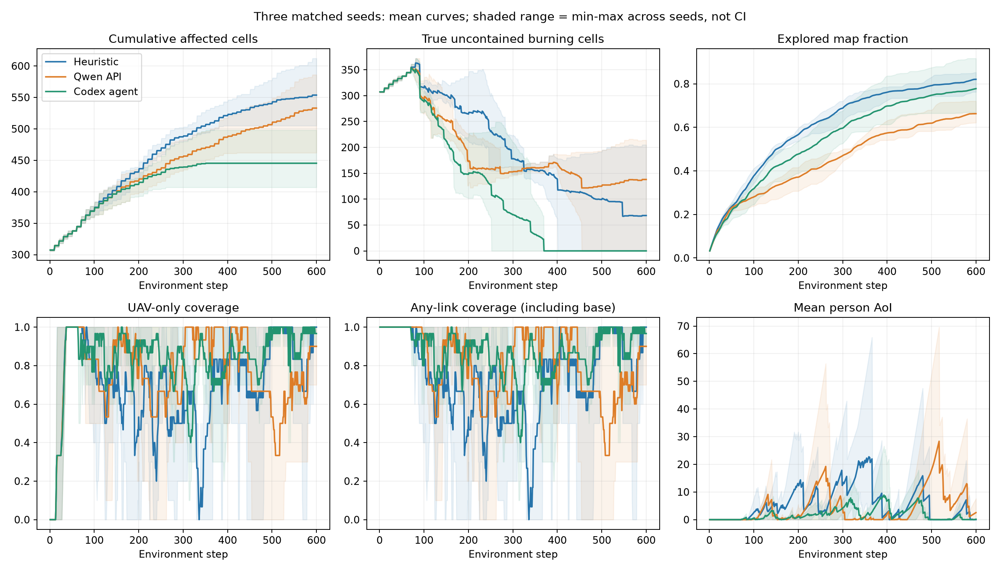
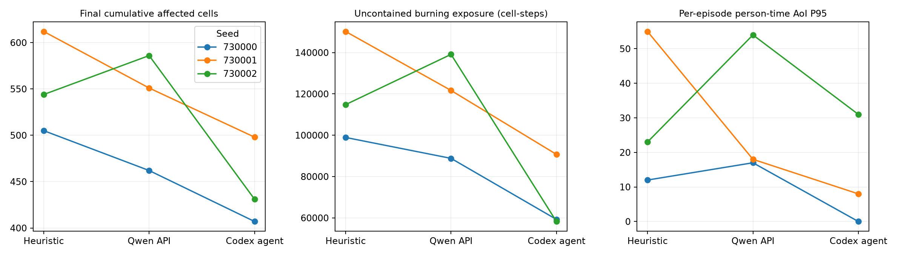
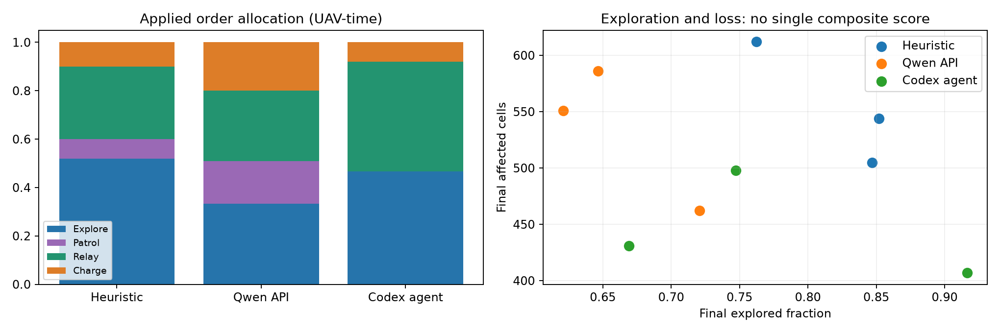

# 无人机大小脑协同：三种高层规划的多指标对比报告

**比较对象：启发式、千问 API、Codex agent；相同三个种子，每局600步。** 本报告扩展已有实验，未重新规划、调参或调用模型。通过严格重放补记缺失量，九条轨迹共5,400个完整转移均与原数据一致。

共计算 **54 项评价指标**，覆盖任务控制、感知回传、通信时效、能源、执行和角色分配。指标存在相关性，不等于54次独立证据；不拼凑任意加权“总分”。

## 主要判断

Codex agent 在这三个场景的累计过火均低于另外两组，均值 **445.3格**，相对启发式 **-19.6%**；未合围燃烧暴露积分相对变化 **-42.8%**。平均无人机通信覆盖率为 **83.0%**，启发式 **70.0%**。
其代价是最终探索率均值 **77.8%**，低于启发式 **82.0%**。终局好看不能代替过程评价，需结合最长中断、低电量和阻挡指标阅读。

这些结果支持“当前带反馈与工具分析的高层方案有进一步研究价值”，尚不足以证明Codex裸模型强于千问，或证明某一种纠偏措施具有独立贡献。n=3为描述性配对结果，不给显著性结论。

## 1. 实验与口径

- 场景：100×100、4架无人机、10名人员、3个初始火源、随机风；种子730000–730002。
- 同一冻结Actor、纯argmax、每20步规划、相同目标管理与充电保护；每局600步，无提前结束。初态与权重哈希逐对一致。
- 千问使用全量当前真值及现有提示词，正式组无回退。Codex使用同类当前真值的工具摘要、持续上下文，并提前知道Actor短板与既有实验结论；启发式只消费自身已有简报字段。有效信息与工具预算不相等。
- 三个种子是旧基准前三个，运行前固定，但不是新的留出集。原10局千问结论不能直接用不同样本的均值与本3局混比。
- 下表默认是每局先计算指标、再对三个种子取等权均值；区间范围见CSV。事件计数为每局均值。
- UAV覆盖率只算无人机贡献；通信可用率含基站。AoI按环境通信阶段字段记录，不能把当前位置的几何覆盖与这一字段逐格强行对齐。
- 信息召回以真实燃烧格·步加权，避免大量“已无火/已合围”时刻用默认1抬高结果；同时单列未合围火口径。
- 合围意味着不能继续向健康格扩散，并不意味着余火被扑灭；全部烧尽也可能满足“无未合围火”，必须与过火和烧尽量联合评价。

## 2. 分维度指标结果

### 任务结果与火势过程

| 指标 | 启发式 | 千问 API | Codex agent |
|---|---:|---:|---:|
| 最终累计过火格数 ↓ | 553.67 | 533.00 | 445.33 |
| 新增过火格数 ↓ | 252.67 | 232.00 | 144.33 |
| 最终烧尽格数 ↓ | 211.33 | 197.67 | 190.67 |
| 最终已扑灭格数 ↑ | 232.67 | 185.00 | 234.67 |
| 最终仍燃烧格数 ↓ | 109.67 | 150.33 | 20.00 |
| 最终未合围燃烧格数 ↓ | 68.33 | 138.00 | 0.00 |
| 未合围燃烧暴露积分 ↓ | 121,313 | 116,531 | 69,406 |
| 全部燃烧暴露积分 ↓ | 140,435 | 134,166 | 95,896 |
| 累计受灾面积积分 ↓ | 279,467 | 266,433 | 249,723 |
| 终局无未合围燃烧格 ↑ | 2/3 | 1/3 | 3/3 |
| 稳定无未合围火耗时（600步截断） ↓ | 516.00 | 551.67 | 300.33 |
| 燃烧格数峰值 ↓ | 363.00 | 359.00 | 359.00 |
| 最后200步新增过火 ↓ | 32.67 | 46.33 | 0.00 |

积分以格·步计，低值表示较少/较短暴露，不是shaping reward。受限合围时间对未完成局记600，并同时报告终局完成局数；它不能被解释为未完成局真实完成耗时。

### 感知与信息回传

| 指标 | 启发式 | 千问 API | Codex agent |
|---|---:|---:|---:|
| 最终探索率 ↑ | 82.0% | 66.3% | 77.8% |
| 全程平均探索率 ↑ | 60.9% | 45.3% | 54.8% |
| 火情发现率（燃烧格·步加权） ↑ | 46.8% | 44.3% | 82.6% |
| 人员火情认知率（燃烧格·步加权） ↑ | 46.6% | 43.4% | 81.4% |
| 未合围火发现率（加权） ↑ | 38.7% | 35.2% | 75.9% |
| 未合围火人员认知率（加权） ↑ | 38.4% | 34.2% | 74.2% |
| 团队燃烧标记精确率（加权） ↑ | 77.8% | 82.4% | 78.4% |
| 人员燃烧标记精确率（加权） ↑ | 77.8% | 81.9% | 78.3% |
| 最终人员火情认知率 ↑ | 69.1% | 69.7% | 100.0% |
| 发现与人员认知差（加权） ·描述项 | 0.3% | 0.9% | 1.3% |

燃烧标记精确率的FP包括“过去有火、现在已烧尽/扑灭，但认知图仍标燃烧”的过时信息。它不是火势强度误差、也不是全图准确率。发现与认知差可能还受人员自己的观测与融合影响，不能当作纯通信损失的因果量。

### 通信可靠性与信息时效

| 指标 | 启发式 | 千问 API | Codex agent |
|---|---:|---:|---:|
| 平均无人机通信覆盖率 ↑ | 70.0% | 76.5% | 83.0% |
| 平均通信可用率（含基站） ↑ | 74.1% | 81.5% | 87.7% |
| 人员×时间平均AoI ↓ | 5.64 | 4.33 | 1.88 |
| 人员×时间AoI P95 ↓ | 30.00 | 29.67 | 13.00 |
| 人员×时间AoI P99 ↓ | 56.00 | 49.67 | 29.67 |
| AoI>20的人员时间占比 ↓ | 10.3% | 8.5% | 3.2% |
| 最差人员的平均AoI ↓ | 7.56 | 5.92 | 3.79 |
| 最长连续通信中断 ↓ | 69.00 | 65.00 | 49.00 |
| 长度≥20步的中断段数 ↓ | 28.33 | 18.33 | 11.33 |

### 补给与能源安全

| 指标 | 启发式 | 千问 API | Codex agent |
|---|---:|---:|---:|
| 全程最低剩余电量 ·描述项 | 185.83 | 18.33 | 60.00 |
| 最低理想返航余量 ·描述项 | 182.50 | 15.83 | 53.33 |
| 理想返航余量<0占比 ↓ | 0.0% | 5.0% | 0.0% |
| 曾在步后耗尽的无人机数 ↓ | 0.00 | 0.33 | 0.00 |
| 步后零电量时间占比 ↓ | 0.0% | 5.0% | 0.0% |
| 站外零电量无人机步数 ↓ | 0.00 | 120.33 | 0.00 |
| 进入补给坪次数 ·描述项 | 23.00 | 16.00 | 18.67 |
| 处于补给坪时间占比 ·描述项 | 4.1% | 10.9% | 4.7% |

返航余量是忽略碰撞延误的可达下界，非负不保证安全。补给坪进出次数会受站边抖动影响；进入补给坪不等于一次独立高效补给。模型每步基础能耗固定，因此不把总航程或剩余电量冒充真实节能成绩。

### 规划执行与运动行为

| 指标 | 启发式 | 千问 API | Codex agent |
|---|---:|---:|---:|
| 碰撞阻挡的无人机时间占比 ↓ | 0.1% | 2.2% | 0.6% |
| 越界动作尝试占比 ↓ | 0.0% | 0.0% | 0.0% |
| 四机实际总航程 ·描述项 | 3101.55 | 2615.00 | 2999.28 |
| 实际移动的无人机时间占比 ·描述项 | 99.1% | 87.3% | 95.9% |
| 悬停动作占比 ·描述项 | 0.8% | 5.6% | 3.5% |
| 相邻移动立即折返率 ·描述项 | 22.2% | 29.2% | 31.4% |
| 有效探索窗口无进展占比 ↓ | 0.6% | 0.0% | 0.9% |
| 实际逐机指令变更数 ·描述项 | 60.67 | 56.00 | 63.33 |
| 规划被目标管理改写比例 ·描述项 | 64.4% | 30.0% | 2.2% |
| 安全协议强制改充电次数 ↓ | 0.00 | 7.00 | 0.00 |

折返、停留、切换本身不一定有害：中继、补给和观察都可能需要停留。探索无进展只统计同一显式目标且起始距离>5的稳定20步片段，不等于通用指令服从率；被提前改派片段和到位后的驻留不进入分母。

### 实际任务分配

| 指标 | 启发式 | 千问 API | Codex agent |
|---|---:|---:|---:|
| 探索指令时间占比 ·描述项 | 51.9% | 33.3% | 46.7% |
| 巡逻指令时间占比 ·描述项 | 8.1% | 17.6% | 0.0% |
| 中继指令时间占比 ·描述项 | 30.0% | 29.2% | 45.3% |
| 补给指令时间占比 ·描述项 | 10.0% | 19.9% | 8.1% |

这里只统计实际指令标签。Codex部分explore航点兼顾观测与定位覆盖，不能直接把explore标签时间全部当成有效搜图时间。

## 3. 逐种子配对结果

| 种子 | 规划器 | 过火 | 烧尽 | 扑灭 | 未合围暴露积分 | 稳定合围步 | 探索率 | UAV覆盖 | AoI P95 | 最长中断 | 耗尽架数 |
|---|---|---:|---:|---:|---:|---|---:|---:|---:|---:|---:|
| 730000 | 启发式 | 505 | 198 | 264 | 98,923 | 401 | 84.7% | 83.5% | 12.0 | 38 | 0 |
| 730000 | 千问 API | 462 | 176 | 259 | 88,802 | 455 | 72.1% | 85.3% | 17.0 | 59 | 0 |
| 730000 | Codex agent | 407 | 170 | 230 | 59,248 | 279 | 91.7% | 90.0% | 0.0 | 19 | 0 |
| 730001 | 启发式 | 612 | 224 | 170 | 150,205 | 600步未完成 | 76.2% | 50.4% | 55.0 | 104 | 0 |
| 730001 | 千问 API | 551 | 209 | 139 | 121,667 | 600步未完成 | 62.1% | 78.9% | 18.0 | 45 | 1 |
| 730001 | Codex agent | 498 | 204 | 248 | 90,725 | 370 | 74.7% | 83.1% | 8.0 | 60 | 0 |
| 730002 | 启发式 | 544 | 212 | 264 | 114,811 | 547 | 85.2% | 76.1% | 23.0 | 65 | 0 |
| 730002 | 千问 API | 586 | 208 | 157 | 139,123 | 600步未完成 | 64.7% | 65.5% | 54.0 | 91 | 0 |
| 730002 | Codex agent | 431 | 198 | 226 | 58,245 | 252 | 66.9% | 76.0% | 31.0 | 68 | 0 |

稳定合围时间来自新增逐步真值记录，替代旧报告每20步快照首次确认时刻；两者口径不同，差1–19步不表示数据冲突。

## 4. 过程图与取舍

阴影为三个种子的最小—最大范围，不是置信区间。

## 5. 阶段里程碑

首次达到阈值不表示此后一直保持；信息率会因火势变化下降。`—`表示600步内未到达，不能按0步处理，也不只对到达局取均值冒充全组速度。

| 种子 | 规划器 | 首次扑灭 | 扑灭100格 | 扑灭200格 | 探索50% | 探索70% | 探索80% | 人员认知90% |
|---|---|---:|---:|---:|---:|---:|---:|---:|
| 730000 | 启发式 | 100 | 230 | 369 | 140 | 282 | 446 | 243 |
| 730000 | 千问 API | 71 | 173 | 418 | 302 | 509 | — | 363 |
| 730000 | Codex agent | 71 | 154 | 260 | 167 | 309 | 378 | 67 |
| 730001 | 启发式 | 108 | 253 | — | 167 | 382 | — | — |
| 730001 | 千问 API | 73 | 174 | — | 341 | — | — | — |
| 730001 | Codex agent | 73 | 182 | 340 | 193 | 497 | — | 66 |
| 730002 | 启发式 | 84 | 168 | 462 | 150 | 284 | 475 | 225 |
| 730002 | 千问 API | 107 | 190 | — | 320 | — | — | 518 |
| 730002 | Codex agent | 84 | 140 | 239 | 280 | — | — | 49 |

## 6. 从数据中能得出什么

- 优先看累计过火、烧尽、未合围暴露与合围耗时，判断是否更早抑制了火势；再看探索与有效火情召回，判断信息获取的取舍。最终探索率高不自动代表灭火更好。
- 通信应同时看覆盖均值、AoI尾部、最差人员和长中断事件。均值改善不代表每个人始终在线，不能省略第三局等困难场景。
- Codex在反馈中调整了感知位置、人员分组、补给交接、占位冲突和固定点位置。任务与过程指标可以检验结果是否改善，但本轮未做这些措施的独立消融，不能给各措施分配贡献百分比。
- 高频重规划不是本轮自动成立的解释：三组周期相同，实际切换由指令与公共协议共同决定。协议改写也不自动等于模型出错，可能是合法的目标完成更新。
- 信息组织、工具计算、已知Actor能力和持续反馈都与模型类型一起变化。因此本轮可比较整体方案价值，不能孤立归因于参数规模、提示词或模型品牌。

## 7. 不能据现有数据报告的指标

没有人员伤亡/真实救援完成定义、真实飞行动力学功耗、实际飞行秒与步长映射，也没有异步推理期间环境演化，因此不虚构“救援成功率”“真实节能率”“实时安全率”或决策过期损失。也没有对原始九局重新采样模型输出。

## 8. 调用成本与速度口径

| 项目 | 数值 | 解释 |
|---|---:|---|
| 原三局千问正式决策 | 90次 | 来自原实验，含已付费有效前缀，非本次新调用 |
| 原三局千问输入/输出token | 12,754,309 / 8,165 | 正式响应usage之和，不含初次故障混合轨迹的额外支出 |
| 千问历史规划中位/P95 | 17.53s / 25.15s | 不把免费重放耗时当推理速度 |
| Codex交互等待中位/P95 | 26.55s / 44.47s | 包含读状态、工具交互、三局并行调度等待，不能作为裸模型推理排名 |
| 本次扩展报告新增外部API调用 | 0 | 九条已存计划的确定性重放 |

Codex会话额度并非免费，现有记录没有可靠token账单，未估计货币费用。所有仿真均在规划时暂停，速度表不是实时部署测试。

## 9. 交付与复现

- `report.md`与`report.html`：同一完整报告；HTML内嵌图片，可独立打开。
- `metrics_by_episode.csv`：9局全部指标；`metrics_summary.csv`：三组均值、样本标准差与范围；`paired_differences.csv`：每种子Codex减两种基线的差值。
- `metric_definitions.csv`：每项指标的单位、方向和精确定义；`analysis.json`：机器可读结果、里程碑与原始指标。
- `instrumented_replays/<arm>_<seed>/extra_steps.jsonl`：新增逐步量；`verification.json`：与原始600步完整轨迹一致；`audit.json`：全局核验。
- 原始决策与轨迹继续保留在 `research_outputs/codex_brain_3runs_20261022/` 和 `research_outputs/brain_comparison_20261022_recovered/`，未改写。
- 源码 `experiments/comprehensive_comparison/enrich.py` 与 `analyze.py`，副本和哈希保存在本目录；环境依赖沿用项目Python3.13，不需API。

### 指标字典

| ID | 指标 | 单位 | 精确定义 |
|---|---|---|---|
| affected | 最终累计过火格数 | 格 | t600时 burning_state>0，含燃烧/烧尽/扑灭 |
| new_affected | 新增过火格数 | 格 | 最终累计过火减t0初始过火，同种子初始相同 |
| burnout | 最终烧尽格数 | 格 | t600时 burning_state==2；不等于所有过火 |
| extinguished | 最终已扑灭格数 | 格 | t600时 burning_state==3；需与受灾面积联合判断 |
| burning_final | 最终仍燃烧格数 | 格 | t600时0<burning_state<2，含已合围余火 |
| active_final | 最终未合围燃烧格数 | 格 | 真值活火连通区中仍有健康可燃邻居的格数 |
| active_auc | 未合围燃烧暴露积分 | 格·步 | sum(t1..600)真实未合围燃烧格数，不含已合围余火 |
| burning_auc | 全部燃烧暴露积分 | 格·步 | sum(t1..600)全部真实燃烧格数，含已合围余火 |
| affected_auc | 累计受灾面积积分 | 格·步 | sum(t1..600)累计过火格数，越早受灾越大 |
| controlled_final | 终局无未合围燃烧格 | success | t600真值未合围燃烧为0；烧尽也可能满足，非独立成功定义 |
| contain_time | 稳定无未合围火耗时（600步截断） | 步 | 最后一次真值未合围燃烧>0之后的首步；未完成记600并另报命中 |
| peak_burning | 燃烧格数峰值 | 格 | max(t1..600)真实燃烧格数 |
| late_new_affected | 最后200步新增过火 | 格 | t600累计过火减t400累计过火 |
| explore_final | 最终探索率 | rate | t600全队已知格占10000格比例 |
| explore_mean | 全程平均探索率 | rate | 600步探索率均值，衡量探索形成的时效 |
| team_recall | 火情发现率（燃烧格·步加权） | rate | sum团队地图正确标燃烧TP / sum真实燃烧格，分母不人为补1 |
| person_recall | 人员火情认知率（燃烧格·步加权） | rate | sum人员共享地图正确标燃烧TP / sum真实燃烧格 |
| active_team_recall | 未合围火发现率（加权） | rate | sum团队TP与真值未合围火交集 / sum真值未合围燃烧格 |
| active_person_recall | 未合围火人员认知率（加权） | rate | sum人员TP与真值未合围火交集 / sum真值未合围燃烧格 |
| team_precision | 团队燃烧标记精确率（加权） | rate | sum团队TP / sum团队TP+FP；FP含过时燃烧标记 |
| person_precision | 人员燃烧标记精确率（加权） | rate | sum人员TP / sum人员TP+FP；不等于整张地图准确率 |
| final_person_recall | 最终人员火情认知率 | rate | 原指标t600，真实燃烧为0时按环境定义返回1 |
| knowledge_gap | 发现与人员认知差（加权） | rate | 加权团队召回减加权人员召回；不是纯链路因果损失 |
| uav_coverage | 平均无人机通信覆盖率 | rate | 按环境coverage_rate，仅计UAV贡献，不含基站 |
| comm_coverage | 平均通信可用率（含基站） | rate | 环境comm_coverage_rate，基站或任意UAV均可 |
| aoi_mean | 人员×时间平均AoI | 步 | 600×10个person_aoi均值，字段按通信阶段记录 |
| aoi_p95 | 人员×时间AoI P95 | 步 | 每局6000个人员时间样本的95分位，再跨局取均值 |
| aoi_p99 | 人员×时间AoI P99 | 步 | 每局6000个人员时间样本的99分位，再跨局取均值 |
| aoi_over20 | AoI>20的人员时间占比 | rate | count(person_aoi>20)/6000 |
| worst_person_aoi | 最差人员的平均AoI | 步 | 先每人600步平均，再取该局10人最大值 |
| blackout_max | 最长连续通信中断 | 步 | 每人AoI>0的连续段最大长度；含基站口径 |
| long_blackouts | 长度≥20步的中断段数 | 次 | 每人AoI>0连续段中长度≥20的段数，终局段右删失 |
| blocked_rate | 碰撞阻挡的无人机时间占比 | rate | 环境u.blocked为真次数/2400，非真实相撞事故数 |
| oob_rate | 越界动作尝试占比 | rate | 环境u.oob为真次数/2400，环境拒绝动作 |
| path_length | 四机实际总航程 | 格 | 逐步实际位移欧氏长度之和，斜步sqrt(2)，不评价越少越好 |
| move_rate | 实际移动的无人机时间占比 | rate | 非零实际位移/2400，停留可能是有意中继/补给 |
| hover_action_rate | 悬停动作占比 | rate | action==8次数/2400，与被阻挡不动区别开 |
| reverse_rate | 相邻移动立即折返率 | rate | 连续两步均移动且后一位移恰为前一步反向/连续移动对数 |
| explore_stall | 有效探索窗口无进展占比 | rate | 20步内固定显式explore目标、初始距>5且全段未改派，末距未减少超过1格的窗口占比；非通用服从率 |
| instruction_changes | 实际逐机指令变更数 | 次 | 相邻步实际order字典变化总数，包含公共协议变化 |
| protocol_rewrite | 规划被目标管理改写比例 | rate | 每次规划规范化requested与applied任意机不同的次数/30，合法自动更新也计入 |
| safety_charge_changes | 安全协议强制改充电次数 | 次 | 每步目标管理后/原上一指令非charge，但公共充电保护后变charge的逐机次数 |
| min_energy | 全程最低剩余电量 | 电量单位 | 全部2400个步后电量的最小值，非耗能效率 |
| min_margin | 最低理想返航余量 | 电量单位 | 电量减最近真实站点无阻挡8邻域最少步数×2.5，负值有风险，非安全保证 |
| unsafe_margin_rate | 理想返航余量<0占比 | rate | 负返航余量的无人机时间/2400，不含碰撞绕行额外耗能 |
| depleted_ever | 曾在步后耗尽的无人机数 | 架 | 4架中任意步后energy<=0的数量 |
| zero_energy_rate | 步后零电量时间占比 | rate | energy<=0的无人机时间/2400 |
| stranded_steps | 站外零电量无人机步数 | 机·步 | energy<=0且不在任何真实补给坪的次数 |
| pad_entry_visits | 进入补给坪次数 | 次 | 每机at_pad从假到真计1，进出抖动会重复计入，不是有效补给会话 |
| at_pad_rate | 处于补给坪时间占比 | rate | 4机×600步里落在真实补给坪的比例，含满电停留 |
| role_explore | 探索指令时间占比 | rate | 实际task=fire_sensing,mode=explore的无人机时间/2400，含用于位置保持的航点 |
| role_patrol | 巡逻指令时间占比 | rate | 实际task=fire_sensing,mode=patrol的无人机时间/2400 |
| role_relay | 中继指令时间占比 | rate | 实际task=comm_relay的无人机时间/2400 |
| role_charge | 补给指令时间占比 | rate | 实际task=recharge的无人机时间/2400；途经充电不一定是该任务 |
